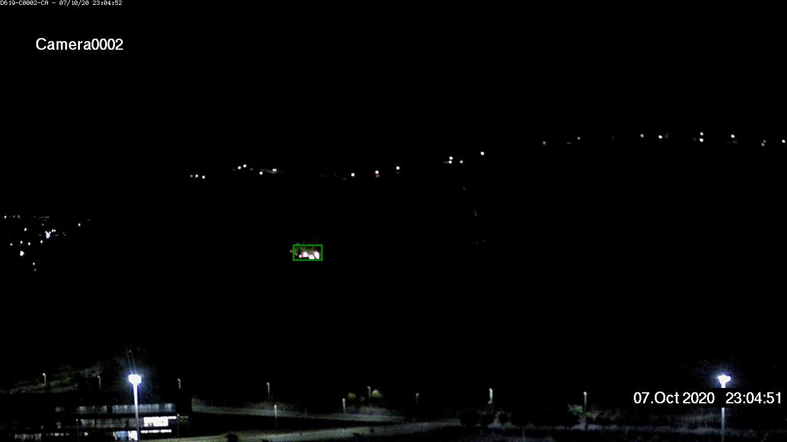
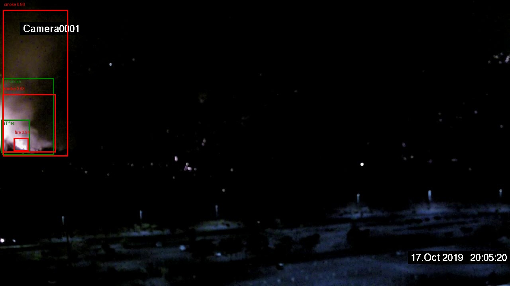
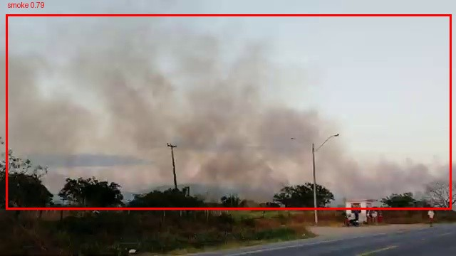
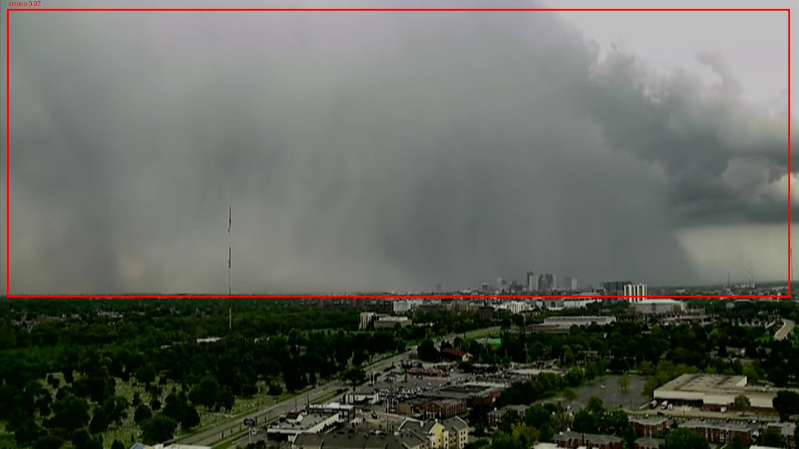
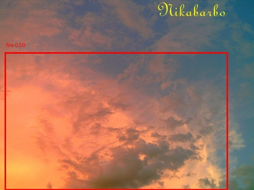
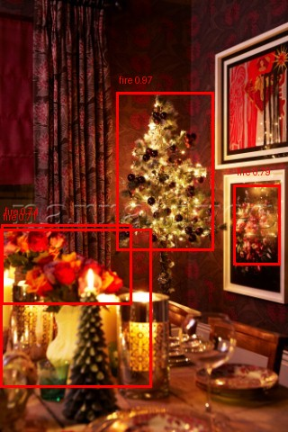

# Evaluation Report — Baseline and Second Model

**Evaluation lead:** Ekaterina Kuznetsova

**Confidence threshold protocol.**
- `score_low = 0.001` — floor for mAP; mAP is threshold-independent.
- Operating threshold for P/R/F1 — **validation-tuned per model**:
  YOLOv8s @ **0.30**;
  Faster R-CNN @ **0.55**.
- FRCN is additionally reported at 0.30 (inherited for a unified-comparison point)
  and 0.70 (near its F1-maximum and within the FP budget) for transparency.
---

## 1. Main metrics

| Model | mAP@0.5 | mAP@0.5:0.95 | smoke AP@0.5:0.95 | fire AP@0.5:0.95 |
|---|---:|---:|---:|---:|
| **Faster R-CNN R50-FPN** (ep 6) | **0.7687** | **0.4112** | **0.4700** | **0.3523** |
| **YOLOv8s** (ep 17, SGD rerun) | 0.6348 | 0.3423 | 0.3972 | 0.2874 |
| Δ (FRCN − YOLO) | **+0.134** | **+0.069** | **+0.073** | **+0.065** |

Both mAP metrics are **threshold-independent**: they are computed over the full
precision-recall curve with `score_low=0.001`, NMS IoU 0.7, max_det 100.

---

## 2. Per-class P / R / F1

P/R/F1 are **threshold-dependent**: they describe the model at a specific operating
point.

### 2.1. Faster R-CNN @ conf=0.55 (validation-tuned)

| Class | Precision | Recall | F1 | TP | FP | FN |
|---|---:|---:|---:|---:|---:|---:|
| smoke | 0.680 | 0.853 | **0.756** | 1964 | 925 | 339 |
| fire  | 0.538 | 0.767 | **0.633** | 2209 | 1893 | 669 |

### 2.2. YOLOv8s @ conf=0.30 (validation-tuned)

| Class | Precision | Recall | F1 | TP | FP | FN |
|---|---:|---:|---:|---:|---:|---:|
| smoke | 0.735 | 0.662 | 0.697 | 1524 | 549 | 779 |
| fire  | 0.670 | 0.475 | 0.556 | 1366 | 673 | 1512 |

### 2.3. Sensitivity: FRCN at three operating points

To make threshold sensitivity explicit, we report FRCN at three points:

| Threshold | smoke P | smoke R | smoke F1 | fire P | fire R | fire F1 | macro F1 | FP/img | FP/empty |
|---|---:|---:|---:|---:|---:|---:|---:|---:|---:|
| 0.30 (inherited) | 0.546 | **0.888** | 0.676 | 0.411 | **0.830** | 0.549 | 0.613 | 1.103 | 0.128 |
| **0.55 (tuned)** | **0.680** | 0.853 | **0.756** | **0.538** | 0.767 | **0.633** | **0.694** | 0.697 | 0.078 |
| 0.70 (F1-biased) | **0.758** | 0.823 | **0.789** | **0.618** | 0.722 | **0.666** | **0.728** | **0.420** | **0.044** |

**Observation.** The validation sweep selected 0.55 by micro-F1. At that point,
FRCN's FP/img is **0.697 — above the project FP budget of 0.5**. If the FP budget
is treated as a hard constraint, a higher threshold (~0.65–0.70) is required. Both constraints are shown; the choice depends on the
deployment objective.

**Interpretation:**

- **YOLOv8s is precision-oriented** (high P, moderate R at its locked threshold).
- **Faster R-CNN is recall-oriented at 0.30** (very high R, low P) and becomes
  **F1-balanced at 0.55-0.70**.
- The F1 of Faster R-CNN **increases by ~10 pp per class** when moving from 0.30 to 0.70.
  This is **not evidence that 0.30 is unfair to FRCN** — it is evidence that
  0.30 is not FRCN's optimal F1 point.

---

## 3. Confusion matrices (rows = GT, cols = pred)

### Faster R-CNN @ 0.55 (tuned)

|              | pred bg | pred smoke | pred fire |
|---|---:|---:|---:|
| **GT bg**    | 0 | 911 | 1882 |
| **GT smoke** | 329 | 1963 | 11 |
| **GT fire**  | 654 | 15 | 2209 |

### YOLOv8s @ 0.30 (tuned)

|              | pred bg | pred smoke | pred fire |
|---|---:|---:|---:|
| **GT bg**    | 0 | 536 | 668 |
| **GT smoke** | 773 | 1523 | 7 |
| **GT fire**  | 1500 | 14 | 1364 |

### (Reference) Faster R-CNN @ 0.30 and @ 0.70

#### Faster R-CNN @ 0.30

|              | pred bg | pred smoke | pred fire |
|--------------|---------|------------|-----------|
| **GT bg**    | 0       | 1688       | 3418      |
| **GT smoke** | 249     | 2043       | 11        |
| **GT fire**  | 472     | 18         | 2388      |

#### Faster R-CNN @ 0.70

|              | pred bg | pred smoke | pred fire |
|--------------|---------|------------|-----------|
| **GT bg**    | 0       | 594        | 1277      |
| **GT smoke** | 399     | 1894       | 10        |
| **GT fire**  | 787     | 12         | 2079      |

**Notes:**

- The `pred bg` column is always 0. This is **correct behaviour** for COCO-style
  detectors: they never output "background" as a class. A 0 in this column
  represents a **false negative**, not a background prediction.
- **Class confusion smoke↔fire is negligible** across all operating points
  (<=29 out of thousands of
  predictions across all runs). The two models do **not** confuse the classes; their gaps are
  localization- and miss-driven.

---

## 4. False-positive analysis across thresholds

### 4.1. FP rate vs confidence threshold

| Threshold | FRCN FP/img | FRCN FP/empty | YOLOv8s FP/img | YOLOv8s FP/empty |
|---|---:|---:|---:|---:|
| 0.10 | 3.650 | 2.685 | 0.755 | 0.102 |
| **0.30** | 1.103 | 0.128 | **0.223** | **0.033** |
| 0.50 | 0.697 | 0.078 | 0.077 | 0.016 |
| **0.70** | **0.420** | **0.044** | 0.016 | 0.005 |

- `FP/empty` — average FP per completely empty test image (2,008 / 4,306); this is
  the **false-alarm rate** relevant to real deployment.
- `FP/img` — average FP across all 4,306 test images (mixes false alarms and
  localization errors).

**Observations:**

- **YOLOv8s meets the project FP budget (<0.5 FP/img)** at 0.30 (0.223). **FRCN exceeds it at its tuned 0.55** (0.697) and needs ≥0.65 to meet the budget.
- **YOLOv8s is consistently 2–5× better on false alarms** at every threshold:
  FP/empty 0.033 vs 0.128 @0.30; FP/img 0.223 vs 1.103 @0.30.
- **FRCN's FP count is highly threshold-sensitive** (10× drop in FP/img from 0.30
  to 0.70) because it produces many low-confidence proposals on hard negatives.
  **YOLOv8s is comparatively robust** (only 3× drop from 0.10 to 0.30, then flat).

### 4.2. Per-model operating points

The project's decision rule ("best mAP@0.5 with FP rate < 0.5 FP/img") is satisfied
by **both models** at an appropriate threshold. The differences are:

| Model | Operating threshold | mAP@0.5 | smoke F1 | fire F1 | FP/img | FP/empty |
|---|---:|---:|---:|---:|---:|---:|
| Faster R-CNN | 0.55 (micro-F1 max) | 0.769 | 0.756 | 0.633 | 0.697 | 0.078 |
| Faster R-CNN | 0.70 (budget-compliant) | 0.769 | 0.789 | 0.666 | 0.420 | 0.044 |
| YOLOv8s | 0.30 (validated) | 0.635 | 0.697 | 0.556 | **0.223** | **0.033** |

- **Faster R-CNN has the higher accuracy** (mAP and F1, both classes).
- **YOLOv8s has the lower false-alarm rate** (2× fewer FP/img, 1.3× fewer FP/empty).
- **Neither dominates on all axes**.

---

## 5. Speed benchmark (controlled)

Measurement scope: GPU-only (preprocessing + forward + NMS), images preloaded in
RAM, `.cpu().numpy()` post-processing excluded, warmup = 2 full passes,
`torch.cuda.synchronize()` around each timed iteration, 100 images benchmarked
per configuration, results averaged over 10 iterations. Both models were run in
the **same Kaggle session on the same T4 instance**, so the **ratio is reliable**.

| Model | Batch | Latency (ms/img) | Throughput (img/s) | Speedup vs FRCN |
|---|---:|---:|---:|---:|
| Faster R-CNN R50-FPN | 1 | 42.2 ± 0.8 | 23.7 | 1.0× |
| Faster R-CNN R50-FPN | 4 | 42.9 ± 0.7 | 23.3 | 1.0× |
| YOLOv8s (adapter) | 1 | 17.7 ± 0.2 | 56.5 | **2.4×** |
| **YOLOv8s (adapter)** | **4** | **13.1 ± 0.2** | **76.6** | **3.3×** |

**Observations:**

- **YOLOv8s is 3.3× faster** than Faster R-CNN at batch=4 (13.1 vs 42.9 ms/img).
- **Faster R-CNN does not scale with batch size** (42.2 → 42.9 ms/img from b=1 to b=4).
  This is expected for two-stage detectors: the ROI head processes a variable-length
  list of proposals per image, so GPU utilisation stays roughly the same regardless
  of batch size.
- **YOLOv8s scales with batch size** (17.7 → 13.1 ms/img), as expected for a
  single-stage detector.
- **Standard deviation is 1–2%** of the mean, so the measurement is stable and
  not an artifact of GPU contention.

**Comparison with per-run FPS in `results/*_test_thr*.json`.** Those numbers come
from a **full end-to-end pipeline** including PIL decoding and `.cpu().numpy()`
transfer of output boxes, and they vary 2–3× across sessions because the Kaggle
free-tier T4 is shared. They are **not comparable across sessions**. The controlled
benchmark above is the **only reliable cross-model speed comparison**.

---

## 6. Failure cases

We report **six representative failure cases** (one per category per model). All six figures (and some more representative failure cases) are in `figures/<model>_failure_cases/`.

### 6.1. Case A — missed fire (FN), YOLOv8s

**Likely cause.** A very small flame, on such image might be mistaken for flashlight. YOLOv8s' fire recall is
0.475 at 0.30 — the lowest recall among the four model/class combinations — so this is the expected failure mode.

### 6.2. Case B — missed fire (FN), Faster R-CNN

**Likely cause.** Prediction with IoU < 0.5 → classified as FN. FRCN actually found fire, but predicted box is much smaller than GT (a localization failure counted as FN). Possibly because on this image fire is heavily occluded by smoke.

### 6.3. Case C — cloud/smoke FP, YOLOv8s

**Likely cause.** Cloud texture and luminance match smoke plumes. The model has
no contrastive cloud-vs-smoke training signal. This is canonical confusion.

### 6.4. Case D — cloud/smoke FP, Faster R-CNN

**Likely cause.** Same failure mode as 6.3. FRCN has 925 smoke false positives at
0.55 (vs YOLOv8s' 536 at 0.30), so the category is shared across
models, though FRCN's are more numerous.

### 6.5. Case E — bright-object fire FP, YOLOv8s

**Likely cause.** Bright orange/yellow region (sunset) resembles fire.

### 6.6. Case F — bright-object fire FP, Faster R-CNN

**Likely cause.** Same failure mode as 6.5, but the dominant error category for
FRCN: 1,893 fire FPs at 0.55. FRCN's ROI head
lacks full-image context and triggers on bright patches near the fire colour
range; this is consistent with the observed fire-FP gap.

### 6.7. Observation

**Both models fail on the same visual categories** (clouds, bright objects,
small fires). What differs is
the **frequency** and **confidence distribution**.

---

## 7. Reproducibility

- Code: `evaluation.ipynb`, `speed_benchmark.ipynb`.
- Environment: Kaggle T4, `ultralytics==8.3.221`, `torchmetrics`, `torch`, `torchvision`.
- Runtime: ~7 min inference + metrics on 4,306 test images per model per threshold.
- Dataset: linxel/dfire-prepared.
- Seeds: dataset splits unchanged. Model checkpoints are the selected validation-best
  checkpoints; evaluation does not re-train.

---

## 8. Known limitations and remaining work

### 8.1. Limitations

1. **Training budget is time-matched, not compute-matched.** LR schedules differ
   (Faster R-CNN epoch-based cosine, YOLOv8s wall-clock cosine). The comparison is
   a **controlled budget-matched study**, not an isolated architecture effect.
2. **Failure cases are manually selected** from the automatically extracted
   candidate pool (`find_failure_cases` in `evaluation.ipynb`), and the choice
   of representative examples is subjective. Six cases across two
   models cover the three main failure categories; more granular distributions
   would require manual labelling of all 500+ FP candidates per model, which
   is out of scope for this submission.
3. **FPS in per-run JSONs** varies 2–3× across sessions; only the controlled
   benchmark is used for cross-model comparison.
